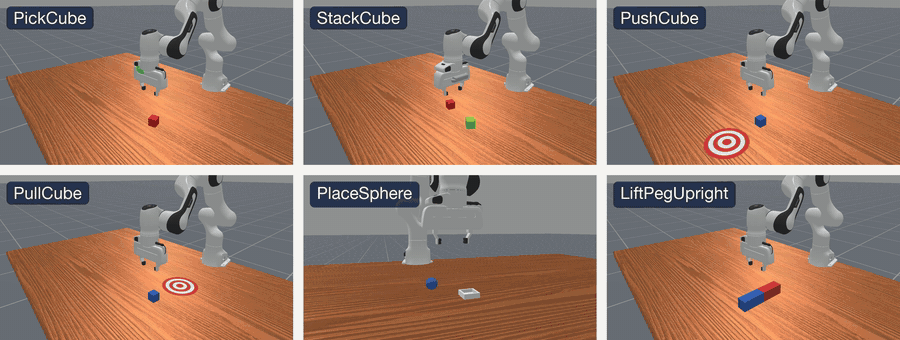
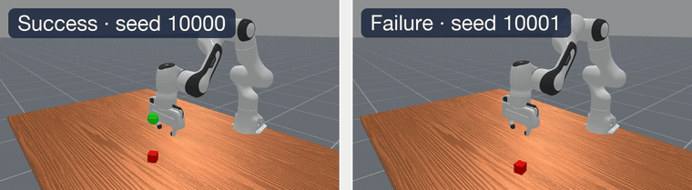
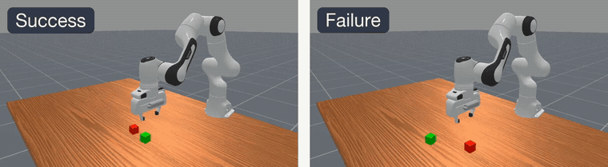
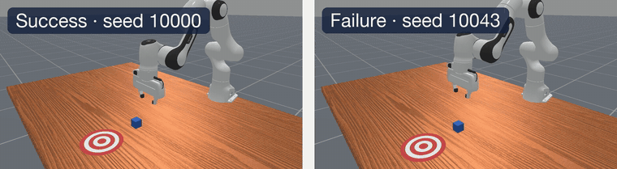
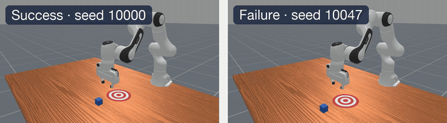
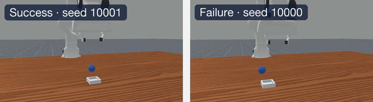
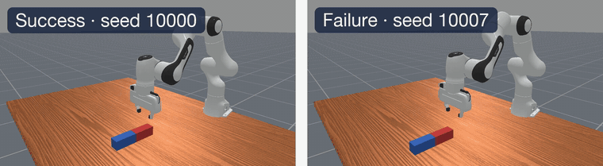
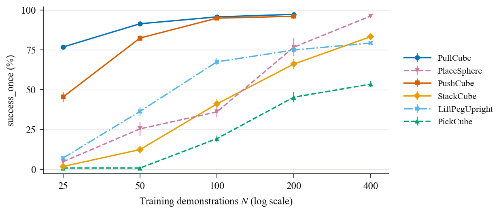
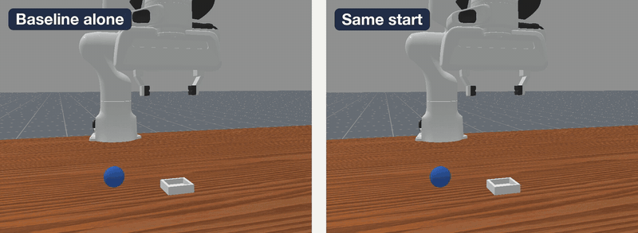
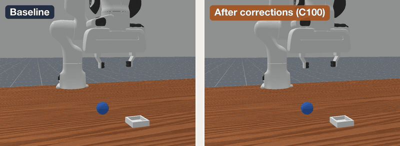

# RGB Diffusion Policies on Six ManiSkill Tasks

**DASC7606C Group 11, The University of Hong Kong — Track 3 (Simulation Experiments)**

We generate our own expert demonstrations for six ManiSkill 3 tabletop tasks, train an
RGB-based [Diffusion Policy](https://diffusion-policy.cs.columbia.edu/) on each, and study
three questions: how many demonstrations a task needs, whether the denoising backbone
matters, and whether expert corrections at the policy's own failures help more than extra
demonstrations.



*Expert demonstrations for the six tasks, generated with ManiSkill's motion-planning solvers.*

| | |
| --- | --- |
| **Report** | [PDF](https://github.com/hryang1130/7606C/releases/download/report-pdf/DASC7606C_Group11_Report.pdf) (release `report-pdf`); LaTeX source in [`report/`](./report) |
| **Videos** | [Release `videos-2026-10-09`](https://github.com/hryang1130/7606C/releases/tag/videos-2026-10-09): every clip on this page in full resolution |
| **Checkpoints** | [Release `checkpoints-unet-n100`](https://github.com/hryang1130/7606C/releases/tag/checkpoints-unet-n100): UNet baselines trained on 100 demonstrations, with run records and test evaluations |
| **Code** | [`maniskill-demogen/`](./maniskill-demogen) generates the data, [`dp-manip/`](./dp-manip) trains and evaluates |

## Tasks

| Task | Skill | Control (action dim.) | Cameras | Horizon | Success rule |
| --- | --- | --- | :---: | :---: | --- |
| PickCube | Grasp, lift | End-effector Δ position (4) | 1 | 100 | Cube within 2.5 cm of the goal, robot static |
| StackCube | Grasp, stack | End-effector Δ position (4) | 2 | 200 | Cube A on cube B, released, static |
| PushCube | Push | End-effector Δ position (4) | 1 | 100 | Cube inside the goal region |
| PullCube | Pull | End-effector Δ position (4) | 1 | 100 | Cube inside the goal region |
| PlaceSphere | Grasp, place | End-effector Δ position (4) | 1 | 200 | Sphere on the bin, robot static, gripper open |
| LiftPegUpright | Reorient | Joint position (8) | 1 | 200 / 400 | Peg upright within 0.08 rad, resting on the table |

Policies see 128×128 RGB images and the robot's proprioceptive state; object poses are never
given to the policy. Each task has 400 training and 50 validation demonstrations. All results
below are measured on 100 held-out test episodes (seeds 10000–10099) per trained run.

## Policy rollouts

One successful and one failed held-out test episode per task.

| | |
| :---: | :---: |
| **PickCube** | **StackCube** |
|  |  |
| **PushCube** | **PullCube** |
|  |  |
| **PlaceSphere** | **LiftPegUpright** |
|  |  |

## Results

Numbers are `success_once` (%): the share of test episodes in which the success condition
holds at any step, as mean ± sample standard deviation over training seeds. The report gives
the confidence intervals, the `success_at_end` metric, and the limits of each comparison.

### 1. How many demonstrations does a task need?

UNet baseline, one shared configuration, 100k training steps for every run.

| Task | N = 25 | N = 50 | N = 100 | N = 200 | N = 400 |
| --- | :---: | :---: | :---: | :---: | :---: |
| PickCube | 0.7 ± 1.2 | 0.7 ± 0.6 | 19.2 ± 1.8 | 45.2 ± 3.1 | 53.4 ± 2.1 |
| StackCube | 1.7 ± 1.2 | 12.3 ± 2.5 | 41.0 ± 2.9 | 66.0 ± 3.1 | 83.2 ± 1.9 |
| PushCube | 45.3 ± 3.2 | 82.3 ± 1.5 | 94.8 ± 1.3 | 96.0 ± 1.9 | – |
| PullCube | 76.7 ± 1.2 | 91.3 ± 0.6 | 95.6 ± 0.9 | 97.2 ± 0.4 | – |
| PlaceSphere | 4.7 ± 2.9 | 25.3 ± 4.1 | 36.0 ± 3.6 | 76.6 ± 5.6 | 96.2 ± 0.8 |
| LiftPegUpright | 7.0 ± 1.0 | 36.3 ± 3.1 | 67.4 ± 2.1 | 74.8 ± 2.8 | 79.2 ± 0.8 |



The curves have a similar shape and differ mainly in where they sit on the data axis: 50%
success needs fewer than 25 demonstrations on PullCube and about 300 on PickCube. N = 400 was
run only where the gain from 100 to 200 was distinguishable from zero, a rule fixed before
the runs.

### 2. Does the denoising backbone matter?

N = 100, five training seeds per cell.

| Task | UNet | Transformer | MLP |
| --- | :---: | :---: | :---: |
| PickCube | 19.2 ± 1.8 | **90.6 ± 4.1** | 79.6 ± 1.9 |
| StackCube | 41.0 ± 2.9 | **41.8 ± 4.8** | 25.0 ± 2.5 |
| PushCube | **94.8 ± 1.3** | 89.0 ± 0.7 | 92.2 ± 2.2 |
| PullCube | 95.6 ± 0.9 | **98.0 ± 1.0** | 91.8 ± 2.2 |
| LiftPegUpright | **71.4 ± 1.7** | 64.6 ± 5.9 | 41.0 ± 9.6 |

No backbone is best on every task. On PickCube the final UNet checkpoint is overfitted, and
switching to the Transformer at N = 100 helps more than quadrupling the UNet's data.

### 3. Do expert corrections help more than extra demonstrations?

On PlaceSphere the N = 100 baseline fails in about two thirds of episodes, almost always at
the grasp. When a rollout misses the grasp, a scripted expert takes over and finishes the
task; these corrections are then added to the training data.



*Collecting a correction: the baseline alone (left) and the same start with the expert taking
over at the missed grasp (right).*

| Arm | Fine-tuning data | Successes / episodes | `success_once` (%) | Δ vs. baseline (pp) [95% CI] |
| --- | --- | :---: | :---: | :---: |
| B | None (baseline checkpoint) | 197 / 600 | 32.8 | – |
| C | Base demonstrations + 100 corrections | 280 / 600 | 46.7 | +13.8 [+9.3, +18.3] |
| D | Base demonstrations + matched extra demonstrations | 194 / 600 | 32.3 | −0.5 [−4.7, +3.5] |



*The same evaluation seed after fine-tuning: only the policy trained on corrections re-grasps
after a miss.*

## Repository layout

| Directory | Contents |
| --- | --- |
| [`maniskill-demogen/`](./maniskill-demogen) | Demonstration generation: motion-planning expert, replay in the policy's control mode, quality checks, export. One command per task. |
| [`dp-manip/`](./dp-manip) | Training and closed-loop evaluation for all tasks, data sizes, and backbones (UNet, Transformer, MLP); the takeover-correction study; rollout video recording. |
| [`report/`](./report) | The final report (LaTeX), its tables, figures, and the scripts that generate them. |
| [`VariDP/`](./VariDP) | Frozen earlier codebase. Its Transformer and MLP backbones were ported into `dp-manip`; it is kept for reference only ([`VariDP/LEGACY.md`](./VariDP/LEGACY.md)). |
| [`docs/media/`](./docs/media) | The animations and the figure on this page. |

## Reproducing the experiments

Both components target a Linux machine with an NVIDIA GPU and install their own environment
with [uv](https://docs.astral.sh/uv/). Their READMEs
([demogen](./maniskill-demogen/README.md), [dp-manip](./dp-manip/README.md), both in Chinese)
cover the details, including the Slurm entry points we used on the cluster.

```bash
# 1. Generate demonstrations for one task (400 training, 50 validation)
cd maniskill-demogen
./setup.sh && ./check_env.sh
./generate.sh pickcube
export DATA_ROOT=$PWD/data/dataset

# 2. Train one run: UNet, 25 demonstrations, training seed 1
cd ../dp-manip
./setup.sh
.venv/bin/python scripts/inspect_dataset.py --data-root "$DATA_ROOT"
.venv/bin/python scripts/train_dp.py \
  --config configs/tasks/pickcube.toml \
  --experiment configs/experiments/data_size.toml --experiment-value 25 \
  --data-root "$DATA_ROOT" --seed 1

# 3. Evaluate a checkpoint on the 100 held-out test episodes
.venv/bin/python scripts/eval_dp.py <run directory>/checkpoints/final.pt --split test

# 4. Record success and failure rollouts of that checkpoint
.venv/bin/python scripts/record_rollout_videos.py <run directory>/checkpoints/final.pt
```

The full matrices are defined by `dp-manip/configs/experiments/data_size.toml` and
`backbone.toml` and are submitted per task with `slurm/train_dual_gpu.sbatch` and
`slurm/eval_dual_gpu.sbatch`.

Fewer of PlaceSphere's expert trajectories pass the quality checks, so it needs more than the
default: `./generate.sh placesphere --n-train 700 --n-val 120`.

## Team

Chu Jiajie, Jin Qizheng, Lu Sen, Shao Chuncheng, Song Zirui, Wang Bowen,
Wong Pak Hung Philip, Yang Haoran, Yang Qihang, Yu Houcheng.

Individual contributions and the LLM usage statement are in the appendix of the report
([`report/sections/07-statements.tex`](./report/sections/07-statements.tex)).

## Acknowledgements

Built on [ManiSkill 3](https://github.com/haosulab/ManiSkill) and its motion-planning
solvers, and on [Diffusion Policy](https://github.com/real-stanford/diffusion_policy). The
UNet denoiser is the implementation shipped with the ManiSkill Diffusion Policy baseline.

## For maintainers: subtree sync

`maniskill-demogen/` and `dp-manip/` are vendored with **git subtree**. Changes are made in
the upstream repositories first and then synced here; do not edit the vendored directories
directly, except for integration and documentation details that belong to this repository.

| Directory | Upstream | How it was added |
| --- | --- | --- |
| `maniskill-demogen/` | [`hollinsStuart/maniskill-demogen`](https://github.com/hollinsStuart/maniskill-demogen) | Full history (no `--squash`) |
| `dp-manip/` | [`hollinsStuart/dp-manip`](https://github.com/hollinsStuart/dp-manip) | `--squash` |

Git remotes are local configuration, so add them once after cloning. For `dp-manip`:

```bash
git remote add dp-manip git@github.com:hollinsStuart/dp-manip.git
git fetch dp-manip
git switch -c integration/update-dp-manip
git subtree pull --prefix=dp-manip dp-manip main --squash
```

`maniskill-demogen` works the same way (remote `demogen`, `--prefix=maniskill-demogen`,
**without** `--squash`). After a sync, install the environment in that directory and verify
it (the full test suite for `dp-manip`; `./check_env.sh` on a compute node for
`maniskill-demogen`), check that `git diff` touches nothing outside the directory, and open
a pull request. Merge it with an ordinary merge commit, not a squash or a rebase.
Contributors to `dp-manip` are listed in
[`dp-manip/CONTRIBUTORS.md`](./dp-manip/CONTRIBUTORS.md).
